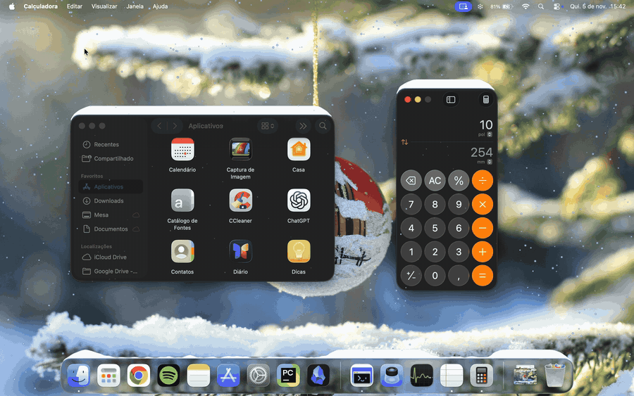
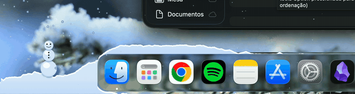

<p align="center">
  
</p>

<h1 align="center">❄️ Neve</h1>

<p align="center"><b>Faz nevar sobre o seu Mac. Pegue um chocolate quente ☕ e veja a neve se acumular.</b></p>

<p align="center">
  
</p>

<p align="center"><a href="docs/demo.mp4">▶ versão em vídeo (melhor qualidade)</a></p>

App nativo de barra de menus para macOS 14+, escrito em Swift 6 com AppKit e Metal, sem dependências externas. A neve cai por cima de tudo, se acumula nas janelas, no Dock e no pé da tela, e nunca bloqueia os seus cliques.

O app segue o idioma do sistema (português ou inglês).

## 🎿 Como brincar

1. **Deixe nevar.** Em alguns instantes a neve forma pilhas no topo das janelas, no Dock e no pé da tela.
2. **Arraste uma janela devagar.** A neve viaja junto com ela. **Sacuda ou arraste rápido** e tudo cai.
3. **Minimize, feche ou esconda** uma janela e veja a neve despencar.
4. **Varra com o cursor.** Ele apaga as pilhas e faz os flocos rodopiarem para longe.
5. **Segure ⌥ (Option)** sobre a neve e arraste: você pega uma bolinha, rola e ela cresce. Solte e empilhe três bolas em ordem decrescente: ☃️ um boneco de neve!
6. **Monte dois bonecos** na mesma superfície, a até 250 pt um do outro, e assista à guerra de bolas de neve.
7. **Quem leva 3 acertos na cabeça perde a cabeça.** Pegue-a com ⌥ e arraste-a de volta para o corpo; ele volta a andar (e a revanche pode rolar).
8. **Escolha Nevasca** em Quantidade, com vento que muda de direção e empurra os bonecos. 🌨️
9. **Segure ⌥ com o cursor parado** perto de um boneco (fora da neve): ele mira e joga uma bola de neve em você. ☃️
10. **Espere visitas:** um coelho ladrão, um passarinho, um pinguim e, bem de vez em quando, o trenó do Papai Noel. 🛷
11. **Varra o cursor sobre um presente** para estourá-lo em confete; **⌥-clique** abre.

## ☃️ Recursos

| | |
|---|---|
| ❄️ **Neve em todo lugar** | Cai sobre a tela inteira, em overlay click-through. Pilhas no topo das janelas (precisam de espaço livre abaixo da barra de menus), no Dock (opcional) e no pé da tela. |
| 🪟 **Janelas vivas** | Cantos arredondados fazem a neve escorregar; o contorno é natural e irregular; a neve acompanha janelas arrastadas devagar e cai se o arrasto for rápido ou a janela for minimizada, fechada ou escondida. Pedaços pesados caem de uma vez. |
| 🖱️ **Cursor** | Passar o cursor derruba a neve acumulada e afasta os flocos em redemoinho. |
| 🌨️ **Intensidade** | Leve, Média, Forte e Nevasca (vento em mudança constante). |
| ☃️ **Boneco automático** | Quando o pé da tela junta neve suficiente, um boneco se monta sozinho: base, corpo, cabeça, olhos e botões de carvão, nariz de cenoura, braços e 🧣 cachecol. |
| ⌥ **Bolas de neve** | Pegue, role, solte e empilhe. Três bolas em ordem decrescente viram um boneco. |
| 🚶 **Bonecos passeiam** | Andam sobre janelas, Dock e pé da tela, com pulinhos e balanço, e brigam com bolas de neve (a cabeça cai e gira com o rosto, o vencedor comemora de braços em V e o perdedor fica de braços caídos). O cachecol esvoaça. |
| 🐇 **Visitantes** | Coelho ladrão, passarinho e pinguim aparecem de vez em quando (opção *Visitantes*); veja a seção abaixo. |
| 🎄 **Árvore de Natal** | Uma árvore cai do alto depois de uma rajada de aviso, pousa sobre uma janela, o Dock ou o chão e solta presentes. Pegue-a com ⌥ + clique (opção *Árvore de Natal*; *Soltar árvore* no menu). |
| 🎁 **Trenó e presentes** | O trenó do Papai Noel cruza a tela no alto e solta presentes sobre os montes (opção *Trenó*). |
| 🎯 **Bola no cursor** | Com ⌥ e o cursor parado perto de um boneco, ele joga uma bola de neve em você. |
| 🧊 **Estalactites** | Crescem sob as janelas congeladas (cheias de neve por ~3 min), com geada na borda, e quebram em placas finas se a janela for arrastada, redimensionada ou varrida. |
| 🏔️ **Avalanche** | Um monte cheio, um solavanco ou um susto no passarinho solta uma frente de placas que pode cair em cascata sobre a janela de baixo. |
| 🧱 **Neve encostada** | Quando uma janela fica rente a outra, mais alta, a neve forma uma rampa contínua até o topo da da frente (e desaba em placas se ela sair). |
| 🖥️ **Janela maximizada** | Com uma janela cobrindo quase tudo, a neve cai só na faixa visível (até o Dock) e o custo cai muito; ao desmaximizar, os montes escondidos voltam. |
| 🎞️ **Quadros adaptativos** | Ligados por padrão, sem opção na interface (há só uma preferência oculta, `adaptiveFps`): 60 fps quando algo rápido acontece e 30 fps quando a nevada está calma. No modo econômico: 30 fps com algo acontecendo e 20 fps com a nevada calma. |
| 🔁 **Troca de Space** | A neve acumulada é preservada ao trocar de Space ou de tela cheia: voltando, os montes continuam lá. |
| 🔭 **Flocos desfocados** | Raramente, um floco grande e desfocado passa em primeiro plano, como se estivesse perto da lente. |
| ⏸️ **Neve parada** | Com Reduzir Movimento, a neve fica parada e o app dorme quando nada muda. |
| 🌱 **Primeira neve** | Numa janela limpa, os primeiros flocos derretem ao tocar e só deixam pontinhos soltos; a camada contínua se forma aos poucos (~1 min na Média). |
| 🏂 **Neve escorrendo do Dock** | Quando a ponta do Dock enche, torrões escorregam pela lateral curva da barra e engrossam o monte do pé da tela até os dois se unirem. |
| 💧 **Derretimento** | Após 5 min sem uso, montes, bonecos e estalactites derretem em ~12 s, com gotas que incham, pingam e respingam; ao voltar, a neve recomeça caindo do topo. |
| 🎵 **Neve dança com a música** | Opcional (macOS 14.2+): batidas viram rajadas de vento, o volume faz os flocos balançarem mais e o grave faz a crista brilhar. Desligado por padrão. |

### 🐇 Visitantes e eventos

Um "diretor de eventos" sorteia visitas com intervalos mínimos (no máximo 3 por tela, nunca todas ao mesmo tempo; no modo econômico, 1). Tudo é desligado com Reduzir Movimento, com *Andam e brigam* desligado e quando a opção *Visitantes* está desligada.

- **Coelho ladrão:** chega saltitando e deixa pegadas na neve, fareja o boneco, rouba a cenoura e foge; o boneco vira e joga bolas nele. Se acertar, a cenoura cai e o boneco corre para recolhê-la; se não, o nariz volta a crescer depois de um tempo.
- **Passarinho:** pousa no topo de uma janela, sacode a neve das penas e fica um pouco. Um tiro por perto, o cursor passando rápido, uma janela mexendo ou um impacto o assusta: ele decola derrubando neve e, se o monte estiver cheio, provoca uma avalanche.
- **Pinguim:** surge atrás de um monte em janelas largas, bamboleia, escorrega de barriga abrindo um sulco e usa uma bola do usuário como rampa.
- **Trenó do Papai Noel:** cruza no alto com renas e brilhos e solta 1 a 3 presentes. Raro no ano (cerca de a cada 3 h), mais frequente em dezembro (a cada ~45 min) e quase sempre presente em 24 e 25/12 (a cada ~10 min). Não aparece no modo econômico nem com janela maximizada.
- **A história:** de vez em quando o coelho vem acompanhado: um passarinho pousa por perto, o coelho rouba a cenoura, o boneco atira, um tiro que erra assusta o passarinho, a neve cai e a avalanche desce pela janela de baixo.

Em modo "Atrás das janelas" ou com janela maximizada só aparecem os visitantes que vivem no chão.

<details>
<summary>Detalhes dos bonecos e das bolas</summary>

- **Boneco automático:** precisa de um trecho livre no pé da tela, a pelo menos 20 pt das pontas do Dock, das bordas da tela e de janelas (se não houver espaço, ele espera). Leva cerca de 1 a 1,5 minuto de nevada. Se o cursor passar por ele ou a neve sob ele for removida (inclusive por Limpar neve), ele desmorona e, depois de uns 2 minutos, outro pode começar. No máximo um por tela.
- **Bolas (⌥):** a bola cresce até uns 40 pt levando a neve do caminho. Ao soltar, ela cai e fica sobre a janela, o Dock ou o chão; uma bola menor solta bem no centro de outra maior fica empilhada, senão rola para o lado. Bolas sobre uma janela acompanham a janela. No máximo 6 bolas soltas por tela (a mais antiga derrete). Passar o cursor sem ⌥ derruba bolas e bonecos. Sem ⌥, os cliques continuam passando.
- **Passeio:** todo boneco completo anda pela superfície onde está, para antes das pontas, dos cantos arredondados e de trechos cobertos por outra janela, dá meia-volta e de vez em quando para um pouco. Com Reduzir Movimento ligado, ficam parados.
- **Briga:** dois bonecos completos na mesma superfície, a até 250 pt, param de frente e alternam arremessos em arco (quanto mais longe, menor a chance de acertar). Acerto vira um espirro de neve. Se a distância passar de 250 pt ou um deles cair, a briga termina sem vencedor. No máximo 2 brigas por tela. Boneco sem cabeça fica parado: solte uma bola do tamanho do corpo do meio (ou menor) bem no centro dele para recolocar a cabeça.
- **Fim da briga:** a terceira bolada na cabeça tira a cabeça do perdedor (ela voa girando, com o rosto, e repousa torta). O vencedor comemora por 2 s com os braços em V; o perdedor fica de braços caídos até a cabeça voltar, quando os braços sobem em 0,3 s e ele volta a andar. Depois de uma briga, os dois descansam uns 12 s.

</details>

## 🧣 Menu

O ícone de floco ❄️ fica na barra de menus e abre um menu nativo (com o botão esquerdo ou o direito). O ícone muda com o estado: floco com uma barra quando a neve está desligada e floco em círculo quando pausada. Todas as opções são lembradas entre execuções. Na primeira vez que o app abre, o menu aparece sozinho uma vez para você achar o ícone; abrir o app de novo pelo Finder enquanto ele roda abre o **Ajustes** e traz o ícone de volta, se estiver oculto.

| Item | O que faz |
|---|---|
| **Nevar** + status | Chave que liga e desliga a neve, com a linha de status embaixo (ex.: "Nevando · Média", "Pausado: app em tela cheia", "Pausado: sem atividade", "Desligado") |
| **Quantidade** | Quatro níveis, em uma linha de ícones, com efeito imediato (também em Ajustes > Geral, com o teclado) |
| **Limpar neve** (⌘K) | Remove neve, bolas e bonecos |
| **Ajustes…** (⌘,) | Abre a janela de ajustes (⌥-clique no ícone também abre a janela direto). Um pontinho laranja aparece aqui, até você abrir o Ajustes uma vez, quando falta a permissão de Acessibilidade (opcional) |
| **Sair** (⌘Q) | Encerra o Neve na hora |

Todo o resto fica em **Ajustes**, uma janela no estilo dos Ajustes do Sistema, com abas na barra de ferramentas (a última aberta é lembrada) e o botão **Restaurar padrões** na aba Sistema:

- **Geral:** *Quantidade*, *Nevar em* (todas as telas, só a principal ou uma tela pelo nome; desativado no modo econômico), *Atrás das janelas* e *Atrás de janelas grandes*.
- **Bonecos:** *Boneco de neve*, *Andam e brigam*, *Visitantes* (coelho, passarinho e pinguim), *Trenó do Papai Noel* e *Árvore de Natal*.
- **Desempenho:** *Modo econômico* (20 fps com a neve calma, 30 com movimento; só a tela principal), *Modo ambiente* (não pausa após 5 minutos sem uso), *Neve dança com a música*, *Cursor empurra os flocos* (os flocos no ar e a neve acumulada: o cursor passa como um limpa-neve e empurra a neve para a frente em um monte arredondado, ou para os dois lados em passadas verticais; só o que passa da borda cai; desligado, o cursor não mexe nela) e *Neve parada* (só com Reduzir Movimento).
- **Sistema:** *Aparecer em capturas de tela* (nem todo app de captura respeita esta opção: no macOS 15.4 ou mais novo o ScreenCaptureKit a ignora, então alguns apps de captura mostram a neve mesmo assim), *Permitir Acessibilidade…* (só quando falta), *Abrir ao iniciar sessão* (não aparece em instâncias de desenvolvimento) e *Restaurar padrões*.

### Dicas

- Segure ⌥ e arraste a neve para fazer bolas.
- Arraste uma janela devagar: a neve vai junto.
- Varra o cursor sobre um presente para estourá-lo em confete; ⌥ e clique em um presente para abri-lo.
- Segure ⌥ com o cursor parado perto de um boneco: ele joga uma bola em você.

### Ícone

`scripts/make-icon.sh` redesenha o ícone (CoreGraphics, `scripts/make-icon.swift`) e gera `Resources/Neve.icns`, que fica versionado; o `make-app.sh` só o copia.

## 🔥 Instalação

### Baixar o app

1. Baixe `Neve-<versão>.zip` em [Releases](https://github.com/viniciuscandeia/neve/releases), descompacte e mova **Neve.app** para `/Applications`.
2. O app não é notarizado (não há conta paga da Apple), então o Gatekeeper bloqueia a primeira abertura. Veja os passos em *Abrir em outro Mac (Gatekeeper)*, abaixo.
3. Para a neve no Dock, conceda **Acessibilidade** em Ajustes do Sistema > Privacidade e Segurança. Ao atualizar para uma nova versão, a permissão pode precisar ser concedida de novo (a assinatura ad-hoc muda a cada build).

### Compilar do código-fonte

Requisitos: macOS 14 ou superior e toolchain Swift 6 (as Command Line Tools bastam; o Xcode não é necessário).

```sh
scripts/make-cert.sh   # uma vez; pede a senha do login para confiar no certificado
scripts/make-app.sh    # gera build/Neve.app
```

1. Mova `build/Neve.app` para `/Applications` (necessário para o item de login funcionar de forma confiável) e abra.
2. no painel do ícone, abra **Ajustes…** e marque **Abrir ao iniciar sessão**. Se o macOS pedir aprovação, ative o Neve em Ajustes do Sistema > Geral > Itens de Início de Sessão.

O Neve permite uma única instância. A permissão de Acessibilidade fica associada à assinatura do app: com a identidade estável "Neve Local Signing" ela sobrevive a recompilações; com a assinatura ad-hoc (usada se a identidade não existir, e `make-app.sh` avisa) ela se perde a cada build.

Para só experimentar, sem empacotar: `swift build -c release && .build/release/Neve`.

<details>
<summary>Abrir em outro Mac (Gatekeeper)</summary>

Para abrir a primeira vez:

- clique com o botão direito no app e escolha **Abrir**; ou, no macOS 15 ou superior, vá em Ajustes do Sistema > Privacidade e Segurança > **Abrir Mesmo Assim**; ou
- rode `xattr -dr com.apple.quarantine /Applications/Neve.app`.

Compilar a partir do código-fonte no próprio Mac de destino evita o bloqueio.

</details>

<p align="center"></p>

## ☕ Desempenho e energia

- Renderização com `CAMetalDisplayLink` e Metal instanciado: todos os flocos em uma única draw call.
- Física sobre um pool fixo de structs, sem alocação por frame no pool de partículas; as pilhas só são redesenhadas quando mudam.
- Acompanhamento de janelas guiado por eventos de Acessibilidade (com rajadas curtas de leitura durante transições e arrastos), com poll leve de segurança (a cada 2 s, ou 5 s quando nada se move).
- A animação **pausa** sob apps em tela cheia, com o Mac em estado térmico alto, após 5 minutos sem uso (a menos que o Modo ambiente esteja ligado) e com as telas em repouso ou a sessão bloqueada.
- Modo de Baixo Consumo do sistema: 30 fps e menos flocos. Modo econômico: 20 fps com a nevada calma (30 com algo acontecendo) e só a tela principal.

## 🔒 Privacidade

- Apenas os limites (bounds) das janelas são lidos. Não exige Gravação de Tela.
- A permissão de Acessibilidade é opcional e serve para dois ganhos: a neve acumular no Dock (Dock na parte inferior da tela) e o acompanhamento de janelas guiado por eventos, mais rápido que o poll. Sem ela, todo o resto funciona (as janelas são lidas por poll).
- *Neve dança com a música* pede a permissão de Gravação de Áudio do Sistema: o áudio é analisado na hora (volume, grave e batidas), nada é gravado nem sai do Mac. Desligar a opção encerra a captura.
- Por padrão a neve tenta ficar fora de capturas e compartilhamentos (funciona com as ferramentas do sistema; no macOS 15.4 ou mais novo o ScreenCaptureKit ignora a opção, então alguns apps de captura e gravadores mostram a neve de qualquer jeito). Ative **Aparecer em capturas de tela** para incluí-la.

## ♿ Acessibilidade

- **Reduzir Movimento:** a neve fica parada (opção "Neve parada") e os bonecos não andam.
- **Aumentar Contraste:** sombra mais forte e contorno azul-escuro nas bolas e bonecos.
- **VoiceOver** ignora o overlay.

## 🌨️ Como funciona

- Uma janela de overlay transparente por tela fica acima das demais e ignora o mouse. Com ⌥ pressionado, ela deixa de ser click-through só sobre a neve ou uma bola.
- Com Acessibilidade, um observador por app avisa quando uma janela é movida, redimensionada, criada, fechada ou minimizada; no máximo 30 vezes por segundo, uma leitura do `CGWindowList` entrega ordem e limites (o AX diz *que* algo mudou, o `CGWindowList` diz *o quê*). Os observadores são ligados um app por vez, para não travar a abertura. Um poll de segurança a cada 2 s (5 s depois de 10 s sem eventos) cobre eventos perdidos. Sem a permissão, o Neve lê o `CGWindowList` a cada 0,5 s; enquanto uma janela é arrastada (botão apertado e o arraste começa no título ou na borda de uma janela, ou com ⌘), as leituras sobem para cerca de 25 por segundo.
- As janelas viram um mapa de superfícies por coluna de pixels; o Dock (lido via Acessibilidade) e o pé da tela também são superfícies. O pé da tela fica atrás de tudo, então janelas e Dock escondem a parte coberta, que guarda a neve até reaparecer.
- Ao pousar, o floco alimenta uma pilha naquela coluna. As pilhas escorregam nos cantos arredondados e desabam quando a janela se move rápido, é minimizada ou fechada.
- O shader Metal é compilado em tempo de execução a partir de código-fonte, porque as Command Line Tools não incluem o compilador `metal`.

## 🛠️ Desenvolvimento

```sh
swift build -c release   # compila
Tests/run.sh             # testes (Swift Testing) + verificação dos shaders
NEVE_SHADER_CHECK=1 .build/debug/Neve   # só compila shaders/pipelines Metal, erros no stderr, sai 0/1 sem abrir janelas
```

`Tests/run.sh --sanitize thread|address [-r] [FILTRO]` compila os testes com o sanitizador (TSan ou ASan) em `.build-thread` / `.build-address` e injeta o runtime do clang das Command Line Tools via `DYLD_INSERT_LIBRARIES` (o runner em si não é instrumentado). `NEVE_BENCH=1 Tests/run.sh -r CalmBench` mede `stepFlakes` contra `writeInstances` por quadro (microbenchmark para decidir `Tuning.interpolateCalm`).

Cada arquivo de código (`Sources/`, `Tests/`, `scripts/`, `Package.swift`) começa com um cabeçalho `AGENT HEADER` escrito para agentes de código: responsabilidade do arquivo, tipos e funções principais, invariantes (unidades em pt, colunas globais x locais, sistemas de coordenadas), dependências, efeitos colaterais, notas de desempenho e armadilhas. **Mantenha o cabeçalho atualizado sempre que alterar o arquivo.**

`NEVE_SCENARIO=heavy` (variável de ambiente) monta um cenário pesado e determinístico (Nevasca, pilhas cheias, bonecos brigando) a cada 20 s, para comparar desempenho.

`NEVE_IDLE_SECS=<segundos>` encurta os 5 min de inatividade (padrão 300): passado o tempo, a neve derrete (~12 s; 0,6 s com Reduzir movimento) e só então a renderização pausa; voltar a usar o Mac durante ou depois do derretimento recomeça a neve caindo do topo da tela.

### Cenas determinísticas (`NEVE_SCENE`)

Roteiros dirigidos pelo tempo de simulação (mesma semente e mesmos quadros de janela, mesma história). Na cena, as opções são fixas (**Aparecer em capturas de tela** ligado, tudo ativo) sem tocar nas preferências salvas, o cursor real é ignorado e só as janelas da cena entram na simulação.

- **`NEVE_SCENE=demo`** (+ `NEVE_SEED`, padrão 7): o Neve abre 3 janelas próprias (Notas, Fotos, Terminal, em cima de um fundo liso, na tela principal) e roda um roteiro de 30 s em loop: 0–4 s neve e rampa de neve encostada; ~6 s surge um segundo boneco e eles brigam; ~12,4 s a cabeça cai e o vencedor comemora; 16 s a cabeça é recolocada; ~17,5 s o passarinho pousa na janela de cima; ~17,5 s o coelho rouba a cenoura e o boneco atira; ~19,8 s um tiro errado assusta o passarinho e a avalanche desce sobre a janela de baixo; 25 s a janela Fotos é arrastada rápido (placas e estalactites se quebram); 22–30 s o trenó cruza e solta presentes. `NEVE_SCENE_WAIT=<s>` atrasa o início do roteiro; `NEVE_SCENE_MARK=<arquivo>` grava a hora Unix do segundo 0 (para alinhar uma gravação).
- **`NEVE_SCENE=fight`** (+ `NEVE_SEED`, padrão 4): dois bonecos a 150 pt no chão; a terceira bolada acontece em T = 3,6 s (comemoração em T+0,3 s, braços abaixados em T+2,2 s), a cabeça volta aos 7 s, o loop reinicia aos 14 s. Os testes conferem esses instantes.

As demais variáveis de demonstração (`NEVE_DEMO_*`, `NEVE_SNOWMAN_FAST`, `NEVE_DIRECTOR_FAST`) estão no fim desta seção. Para gravar o GIF/vídeo do README sem mexer nas janelas do usuário: `NEVE_SCENE=demo scripts/agent-run.sh --screen --name demo -- <gravação>` (a tela fica reservada pelo lock) e, na conversão, corrija a cor (a gravação de tela usa o gama do QuickTime, ≈ 1,96, em vez do sRGB 2,2).

### Vários agentes em paralelo

**Regra: nunca use `pkill`/`pgrep` por nome (`pkill -x Neve` etc.).** Isso derruba o app do usuário e as execuções de outros agentes. Guarde o pid do que você mesmo lançou e mate só ele.

- **Bundle de dev:** `NEVE_DEV=<nome> scripts/make-app.sh` (ou `--dev <nome>`) gera `build/Neve-<nome>.app` com bundle id `io.github.viniciuscandeia.neve.dev`, executável `Neve-dev-<nome>` e `NeveInstance=<nome>` no Info.plist (assinado com a mesma identidade). Sem `NEVE_DEV` o build é o do usuário, como antes. A instância de dev (Info.plist ou env `NEVE_INSTANCE`) não trava por instância única, mostra o nome ao lado do ícone na barra de menus, não tem "Abrir ao iniciar sessão" e grava as preferências só no suite `io.github.viniciuscandeia.neve.dev.<nome>` (nunca no domínio do usuário). A permissão de Acessibilidade vale por bundle id: sem ela, a neve no Dock não aparece e as janelas são acompanhadas por poll.
- **`scripts/agent-run.sh [--screen] [--name N] [--defaults k=v ...] -- <comando...>`:** compila o bundle de dev (nome padrão = hash do diretório do worktree), abre a própria instância, exporta `NEVE_PID`, `NEVE_APP` e `NEVE_DEFAULTS_SUITE`, roda o comando e, ao sair, encerra só esse pid. Com `--screen` pega o lock da tela e mantém `caffeinate -dimsu` durante a execução. Use `--screen` em tudo que depende da tela (capturas, medições).
- **`scripts/dev-lock.sh acquire <dono> [timeout=600] | release <dono> | status`:** lock da tela em `/tmp/neve-screen.lock` (`mkdir` atômico, com dono e pid), espera até o timeout e quebra locks cujo pid morreu. Pode ser carregado com `source` (`neve_lock_acquire`, `neve_lock_release`, `neve_lock_status`). Pelo CLI o pid guardado é o do shell chamador (`NEVE_LOCK_PID` o substitui); em shells de uma chamada só, prefira `agent-run.sh --screen`.
- **`scripts/perf.sh [heavy|media|nevasca|max|still] [segundos=60] [--drag] [--sweep] [--pointer on|off] [--no-figures] [--keep-windows] [--runs N=3] [--bin CAMINHO]`:** mede CPU e wakeups ociosos do Neve e a CPU do WindowServer (via `top`) com janelas do Finder abertas (`max` = janela maximizada; `--drag` arrasta uma janela; `--sweep` passa o cursor rápido pelo topo das janelas e pelo chão e o devolve ao lugar; `--no-figures`, `--capture` (neve aparece em capturas de tela, para conferência visual) desliga bichos, boneco e trenó para a taxa de quadros não depender de sorteio). Antes de medir oculta os outros apps e minimiza as outras janelas do Finder, e devolve tudo no fim (`--keep-windows` pula isso). Roda a própria instância de dev (ou `--bin`), com defaults no suite dela, segura o lock da tela durante todo o teste e mata só o próprio pid. Se o Neve do usuário estiver aberto, avisa que a CPU do WindowServer o inclui (ele não é fechado). Com `NEVE_PERF=1` (sempre ligado no script) mostra o log de fases; os logs ficam em `build/perf-logs/`. A última linha (`SUMMARY`) traz as medianas. Além de CPU, traz `hitch` (milissegundos de atraso por segundo em quadros apresentados além de 1,5× o intervalo previsto; o log também mostra `drops`/s), `power` e `wspower` (Energy Impact do Neve e do WindowServer, coluna POWER do `top`: é uma estimativa, não uma medida de bateria), `memMB` (footprint no fim da execução) e `memGrowMB` (fim menos a primeira amostra).
- **`scripts/perf-suite.sh [--quick]`:** validação de desempenho na tela. Roda o `perf.sh` em cinco cenários (Média e Nevasca, cursor parado e cursor rápido sobre os montes, e cursor rápido longe da neve com o empurrão desligado), compara com o limite de CPU (`MAX_CPU`, padrão 10% de um núcleo; 11% no pior caso, Nevasca com o cursor varrendo os montes sem parar) e com a taxa de quadros esperada, grava `build/perf-report.md` (com colunas de hitch ms/s, energia e memória MB) e sai com erro se algo falhar, incluindo hitch acima de 5 ms/s (`MAX_HITCH`) ou memória acima de 150 MB (`MAX_MEM`; os três quadros de tela cheia do Metal já somam uns 100 MB). Uns 10 minutos (`--quick`: 3); `SECS` e `RUNS` ajustam. Mexe no cursor durante os cenários com varredura: não use o Mac enquanto roda.

Outras variáveis de ambiente de execução: `NEVE_REDUCE_MOTION=1` faz o app se comportar como se Reduzir Movimento estivesse ligado (medições e testes); `NEVE_SLOWMO=<fator>` roda a simulação nessa fração do tempo real (ex.: `0.25`, para conferir animações); `NEVE_DEMO_VANISH=<s>` (só em `NEVE_SCENE=demo`) faz, nesse instante da cena, a janela de cima sumir como se tivesse sido minimizada, com a pilha cheia caindo; `NEVE_DIRECTOR_FAST=1` faz o diretor de eventos sortear visitas (coelho, passarinho, pinguim, trenó) 30 vezes mais seguido.

`NEVE_PERF=1` (opcional `NEVE_PERF_LOG=arquivo`) imprime a cada 5 s fps, tempos por etapa, GPU, CPU e hitch. Os trechos de quadro e simulação também são signposts (`io.github.viniciuscandeia.neve`, categoria `frame`) para o Instruments.

Com apenas as Command Line Tools, `swift test` compila os testes mas não os executa; `Tests/run.sh` carrega o bundle num runner mínimo e os roda.

Para demonstrações, `NEVE_SNOWMAN_FAST=1` faz o boneco se montar 20 vezes mais rápido (e sobre uma pilha mais rasa):

```sh
NEVE_SNOWMAN_FAST=1 .build/release/Neve
```

`NEVE_DEMO_PENGUIN=1` força uma visita do pinguim a cada ~12 s (precisa de uma janela com topo largo e neve acumulada; use com `NEVE_SCENARIO=heavy`).

`NEVE_DEMO_ICE=1` faz as janelas congelarem em ~10 s (geada na borda) e as estalactites embaixo crescerem 120 vezes mais rápido; `NEVE_DEMO_AVALANCHE=<segundos>` enche as pilhas e dispara uma avalanche a cada tanto tempo; `NEVE_DEMO_SLEIGH=1` faz o trenó do Papai Noel cruzar a tela logo depois de abrir (e de novo a cada ~45 s), solta presentes sobre os montes e funciona em qualquer data (sem isso: 24–25/12 a cada ~10 min, dezembro a cada ~45 min, resto do ano a cada ~3 h). Presentes: varrer com o cursor estoura em confete; ⌥-clique abre. Com ⌥ pressionado e o cursor parado por 0,8 s perto de um boneco (e fora da neve), ele joga uma bola de neve no cursor (até 3 por toque, a cada 2 s).

### Build e release

- **Variáveis do `scripts/make-app.sh`:** `NEVE_VERSION` (versão do bundle, padrão 1.0), `NEVE_UNIVERSAL=1` (arm64 + x86_64, dois builds e `lipo`), `NEVE_SIGN` (identidade de assinatura; `-` = ad-hoc) e `NEVE_APP_DIR` (onde gerar `Neve.app`, padrão `build`).
- **`scripts/release.sh VERSÃO`:** gera `dist/Neve-VERSÃO.zip` (universal, assinatura ad-hoc) em `dist/Neve.app`, sem tocar no `build/Neve.app` do dia a dia, e confere executável, bundle id e versão antes de zipar.
- **`scripts/cursor-sweep.swift <segundos> <x0,x1,y>...`:** move o cursor real de um lado a outro de cada segmento (coordenadas CG, ~600 pt/s) e o devolve ao lugar; usado pelo `perf.sh --sweep`, que aceita `SWEEP_SEGS="x0,x1,y ..."` para trocar os segmentos.
- **`NEVE_LOCK_TIMEOUT=<segundos>`:** quanto `agent-run.sh`, `perf.sh` e `perf-suite.sh` esperam pelo lock da tela antes de desistir.

## 📜 Licença

MIT. Veja o arquivo `LICENSE`.
